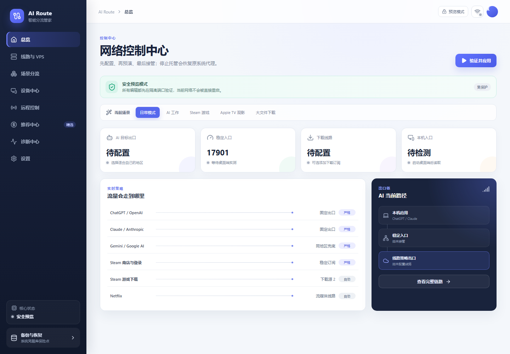

# AI Route Manager

<p align="center">
  <strong>把分流、固定出口、家庭网关和远程连接集中到一个可预演、可验证、可回滚的桌面管理器中。</strong>
</p>

<p align="center">
  <a href="https://github.com/netbreeze76/ai-route-manager/actions/workflows/ci.yml"></a>
  <a href="https://github.com/netbreeze76/ai-route-manager/releases/latest"></a>
  <a href="LICENSE"></a>
  
</p>



AI Route Manager 是一个基于 React、Tauri 和 Rust 的桌面网络策略管理器。它不会提供代理节点、VPN 账号或 VPS，而是帮助用户管理自己合法取得的连接：先生成候选配置，在隔离端口完成验证，再由用户确认是否应用；失败时恢复上一个已验证状态。

## 核心能力

- **场景分流**：分别管理 AI、游戏、流媒体、下载和国内直连策略。
- **严格出口**：AI 严格策略没有合格出口时阻断，不静默回落到 `DIRECT`。
- **安全预演**：候选核心在临时端口运行，验证结束后自动停止并清理临时凭据。
- **凭据隔离**：订阅令牌和 VPS 密码写入 Windows Credential Manager 或 macOS Keychain，不进入普通日志。
- **可恢复变更**：系统代理、Sunshine、防火墙和 OpenWrt/OpenClash 操作均采用备份、冲突检查与回滚流程。
- **诊断与导出**：提供脱敏诊断、移动端配置导出、服务状态与托管修复入口。

完整功能与实现边界见 [`docs/FEATURES.md`](docs/FEATURES.md)，安全模型见 [`docs/SECURITY_MODEL.md`](docs/SECURITY_MODEL.md)。

## 下载

### Windows x64

- [下载安装版 `AI-Route-Manager-1.0.6-Windows-x64-setup.exe`](https://github.com/netbreeze76/ai-route-manager/releases/download/v1.0.6/AI-Route-Manager-1.0.6-Windows-x64-setup.exe)
- [下载便携版 `AI-Route-Manager-1.0.6-Windows-x64-portable.zip`](https://github.com/netbreeze76/ai-route-manager/releases/download/v1.0.6/AI-Route-Manager-1.0.6-Windows-x64-portable.zip)
- [SHA-256 校验文件](https://github.com/netbreeze76/ai-route-manager/releases/download/v1.0.6/SHA256SUMS.txt)
- [全部版本与发布说明](https://github.com/netbreeze76/ai-route-manager/releases)

> [!IMPORTANT]
> 当前公开二进制仅提供 Windows x64。安装包带有 Tauri 更新签名，但尚未购买 Windows Authenticode 商业代码签名，首次运行时 Windows 可能显示信誉提示。macOS 构建与公证脚本已经包含在源码中，但尚未发布经过公证的公共 DMG。

## 快速开始

1. 安装或解压 Windows 版本并启动程序。
2. 在“线路与 VPS”中填写自己的稳定订阅和目标地区；下载订阅与固定 VPS 均为可选项。
3. 保存配置。订阅令牌和密码将进入系统凭据库，界面和普通日志不会回显完整内容。
4. 先运行“安全预演”，确认候选配置、端口和出口检查均通过。
5. 检查预演结果后再选择“验证并应用”；停止托管时软件会恢复先前的系统代理状态。

零基础说明见 [`docs/零基础安装与设置教程.md`](docs/%E9%9B%B6%E5%9F%BA%E7%A1%80%E5%AE%89%E8%A3%85%E4%B8%8E%E8%AE%BE%E7%BD%AE%E6%95%99%E7%A8%8B.md)。在修改网络、路由器或防火墙前，请保留当前可用配置和独立管理入口。

## 支持范围

| 项目 | 当前状态 |
| --- | --- |
| Windows x64 安装版与便携版 | 已公开发布 |
| Windows 本机预演、托管、诊断与恢复 | 已实现并纳入 CI/回归测试 |
| OpenWrt / OpenClash | 支持只读发现、隔离预演、原子下发与失败恢复 |
| Sunshine / RustDesk | 支持最小防火墙向导、配置备份与回滚 |
| macOS 源码构建 | 已提供脚本；公共公证 DMG 尚未发布 |
| Android / iOS 原生应用 | 未发布；当前仅提供配置导出能力 |

## 使用边界

- 本项目不提供节点、订阅、VPN 账号、VPS、破解或规避第三方规则的服务。
- 应用网络配置前必须先查看预演结果；远程操作时尤其需要保留独立恢复通道。
- 推荐中心允许用户完全使用自己的服务。发行者推荐和返利关系必须明确披露，详见 [`docs/REFERRAL_POLICY.md`](docs/REFERRAL_POLICY.md)。
- 使用者应遵守所在地法律法规和相关第三方服务条款。

## 从源码运行

### 前端与桌面开发

```powershell
pnpm install --frozen-lockfile
pnpm check
pnpm build
pnpm tauri dev
```

### Rust 与 Python 测试

```powershell
.\scripts\test-rust-gnu.ps1
python -m pip install --requirement engine\requirements.txt
python -m unittest discover -s engine -p "test_*.py" -v
```

Windows 构建细节由 [`scripts/`](scripts/) 中的可复现脚本维护；macOS 构建与公证流程见 [`docs/BUILD_MACOS.md`](docs/BUILD_MACOS.md)。

## 项目结构

- `src/`：React/TypeScript 桌面界面。
- `src-tauri/`：Rust/Tauri 后端、系统集成与桌面打包配置。
- `engine/`：DynamicProxyEngine 的 Python 源码与回归测试。
- `scripts/`：构建、签名、校验、发布和回滚脚本。
- `docs/`：安装、功能、安全、远控、更新与网关文档。

## 参与项目

- 提交代码前请阅读 [`CONTRIBUTING.md`](CONTRIBUTING.md) 和 [`CODE_OF_CONDUCT.md`](CODE_OF_CONDUCT.md)。
- 安全问题请按 [`SECURITY.md`](SECURITY.md) 私下报告；不要在公开 Issue 中粘贴订阅链接、密码、Cookie、私钥或未脱敏诊断文件。
- 版本变化见 [`CHANGELOG.md`](CHANGELOG.md)。

## 许可证

项目源码以 [`GPL-3.0-only`](LICENSE) 发布。内置第三方组件保留各自许可证、来源和归属，详见 [`THIRD_PARTY_NOTICES.md`](THIRD_PARTY_NOTICES.md)。
